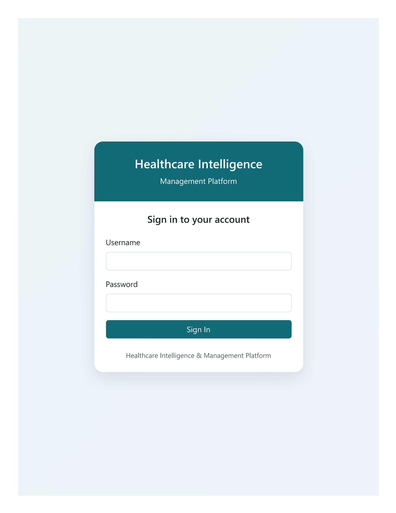
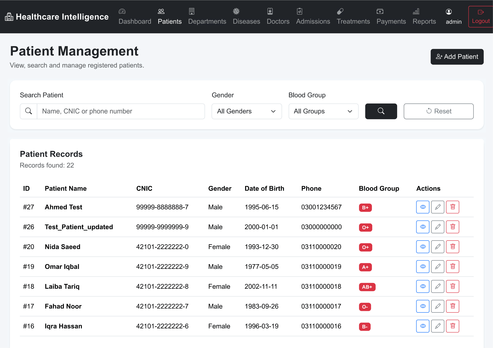
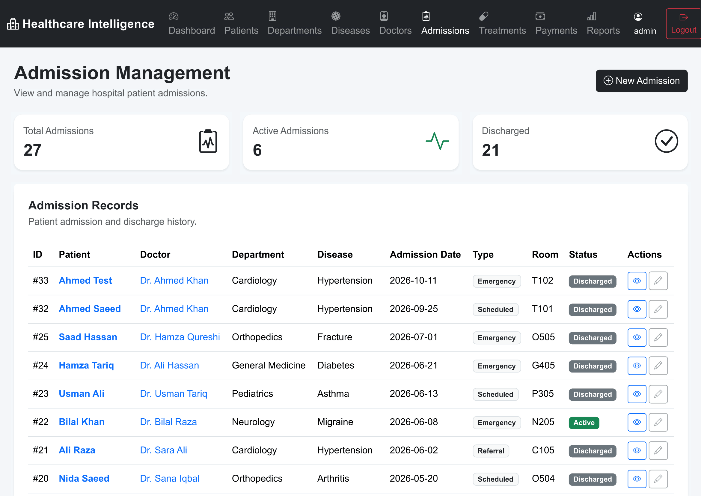
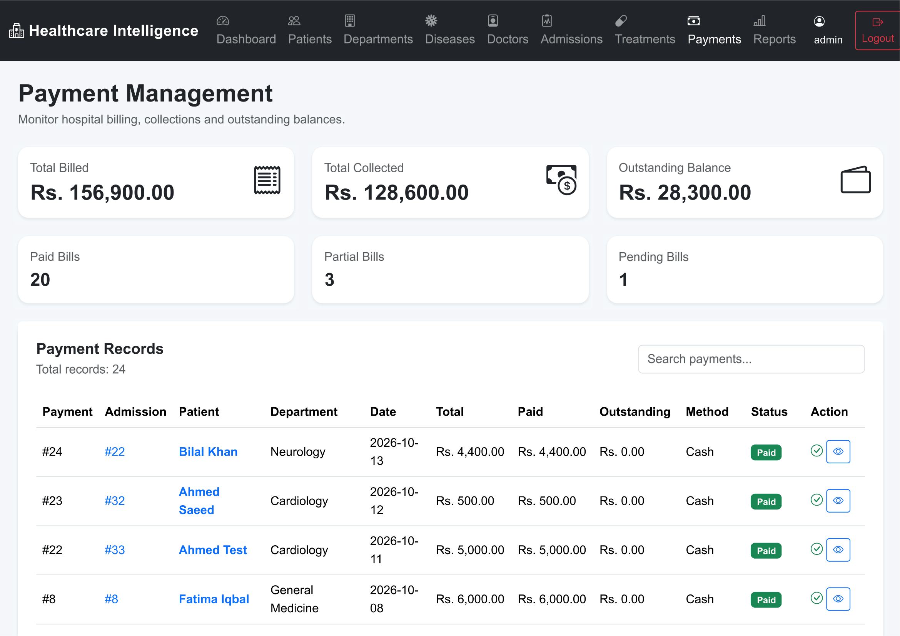
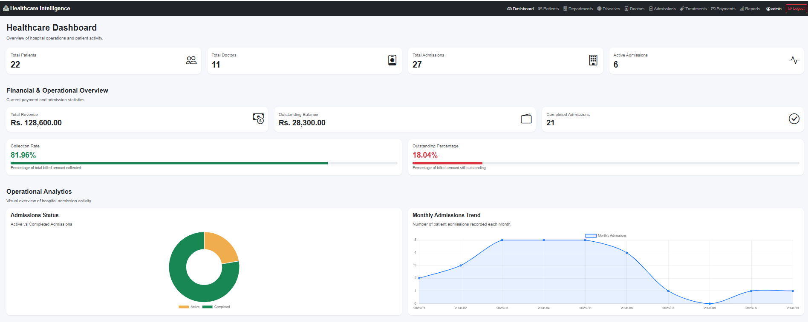
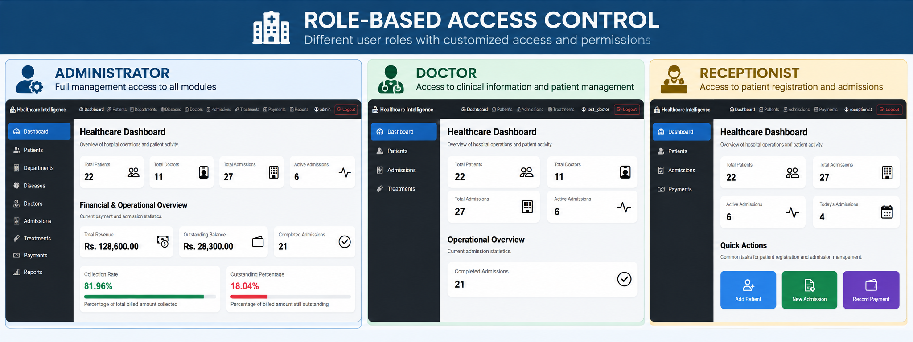

# Healthcare Intelligence & Management Platform

A full-stack healthcare management and analytics portfolio project built with **Python, Flask, MySQL, SQLAlchemy, Jinja2, Bootstrap, and Chart.js**.

The application brings patient administration, clinical workflows, billing, and operational dashboards into a role-based web interface. It was developed as an educational and portfolio project and **is not intended for real-world clinical decision-making or production use without further security, privacy, and compliance work**.

## Features

- **Role-based authentication:** administrator, doctor, and receptionist accounts with server-side access restrictions.
- **Patient management:** patient directory, registration, and profiles.
- **Clinical administration:** doctor and department directories, admissions, treatments, and discharge workflows.
- **Billing and payments:** bills, partial payments, installment transaction history, payment status, and outstanding balances.
- **Financial integrity:** payment validation, database constraints, transactional updates, and reconciliation of opening balances with recorded transactions.
- **Analytics dashboard:** patient and admission statistics, recent admissions, and visual charts; financial information is restricted by role.
- **Reports:** access-controlled reporting for authorized users.
- **Responsive interface:** tested on desktop, tablet, and mobile viewport sizes.

## Technology Stack

| Layer | Technologies |
| --- | --- |
| Backend | Python, Flask |
| Database | MySQL |
| Data access | SQLAlchemy, PyMySQL |
| Authentication | Flask-Login, Flask-Bcrypt |
| Frontend | Jinja2, Bootstrap, HTML, CSS, JavaScript |
| Visualization | Chart.js |
| Configuration | python-dotenv / environment variables |

## User Roles

| Role | Typical access |
| --- | --- |
| Administrator | Platform management, clinical administration, billing, and reports |
| Doctor | Patient and admission information, treatment, and discharge workflows; financial data restricted |
| Receptionist | Patient registration, admissions, and payment operations; administrative reports and clinical-only actions restricted |

Permissions are enforced on the server; hiding navigation items alone is not considered an access control.

## Application Screenshots

### Administrator Dashboard


### Login and Authentication


### Patient Management


### Admission Management


### Treatment Management


### Payment Management


### Financial and Operational Analytics


### Role-Based Access Control


### Doctor Dashboard


## Project Structure

```
Healthcare_Intelligence_Platform/
|
+-- app/
|   +-- routes/
|   |   +-- __init__.py
|   |   +-- auth.py
|   |   +-- main.py
|   +-- static/
|   |   +-- css/
|   |   |   +-- style.css
|   |   +-- js/
|   |       +-- main.js
|   +-- templates/
|   +-- __init__.py
|   +-- models.py
|   +-- permissions.py
+-- run.py
+-- requirements.txt
+-- .gitignore
+-- README.md
```

This shows the principal verified components; additional files and folders may exist in the local project.

## Local Setup

### Prerequisites

- Python compatible with the versions pinned in `requirements.txt`
- MySQL Server
- Git (optional)

### 1. Clone the repository

```powershell
git clone <YOUR_REPOSITORY_URL>
cd Healthcare_Intelligence_Platform
```

### 2. Create and activate a virtual environment

```powershell
py -m venv .venv
.\.venv\Scripts\Activate.ps1
```

### 3. Install dependencies

```powershell
python -m pip install -r requirements.txt
```

### 4. Configure environment variables

Keep credentials in a local `.env` file **that is not committed to Git**. The exact variable names and values must match those read by `app/__init__.py` and your application configuration.

**Before publishing:** add a sanitized `.env.example` showing the actual required variable names, with placeholders instead of secrets.

### 5. Set up MySQL

The application uses a MySQL database named `HealthcareManagementDB` in its development environment.

**Setup instructions still to finalize:** provide a sanitized, version-controlled database schema or migrations and document how to initialize tables and create demo accounts. Do not upload real patient records or a database dump containing personal information.

### 6. Start the application

```powershell
python run.py
```

Open `http://127.0.0.1:5000/` in your browser.

> Note: `run.py` uses Flask's development server. Disable debug mode and use an appropriate production deployment configuration before any public hosting.

## Database Design

The application uses related tables for patients, doctors, departments, diseases, admissions, treatments, and payments.

Payment auditing also uses:

- `payment_transaction` - Records individual payment installments.
- `payment_opening_balance` - Preserves historical collected amounts from before transaction-level tracking was introduced.

Payment reconciliation verifies that recorded collections equal opening balances plus transaction totals.

## Testing Summary

The project has undergone manual checks covering:

- Role-based page access and authorization restrictions.
- Authentication, invalid credentials, logout, and protected routes.
- Database foreign keys, check constraints, and orphan-record checks.
- Payment amount validation, installment recording, and financial reconciliation.
- Invalid URL and nonexistent-record handling.
- Desktop, tablet, and mobile responsiveness.

These checks demonstrate tested behavior, **not a comprehensive independent security audit**.


## Demonstration

A short project walkthrough video will be linked here after recording.

## Security and Privacy

- Never commit `.env`, database passwords, secret keys, virtual environments, or private data.
- Use fictional patient data in public screenshots, demos, and sample databases.
- Do not deploy the Flask development server publicly.
- Production deployment requires further hardening, access-control review, privacy assessment, and appropriate legal/regulatory compliance.

## Future Improvements

- Reproducible database migrations and synthetic seed data.
- Automated unit, integration, and security tests.
- Deployment configuration and operational monitoring.

## Project Status

**Portfolio release preparation:** core development and manual testing completed; public repository documentation, sanitized setup assets, and demonstration materials are being finalized.

## Author

**Hamza Jilani**
Finance, Business Analytics & Data Analytics Portfolio

<!-- Add your LinkedIn and GitHub profile URLs after confirming them. -->
